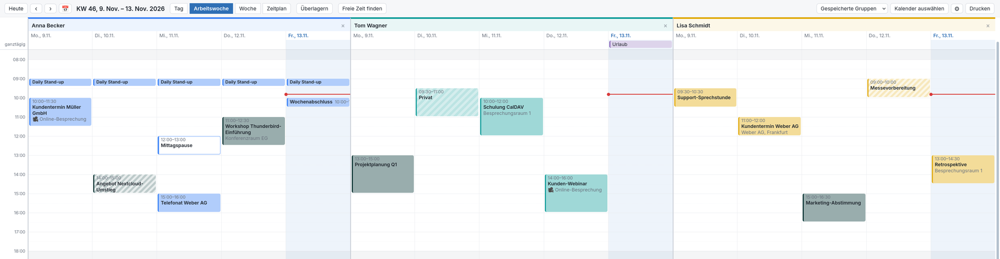
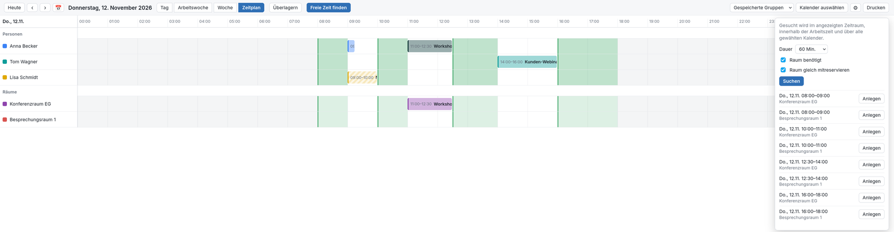
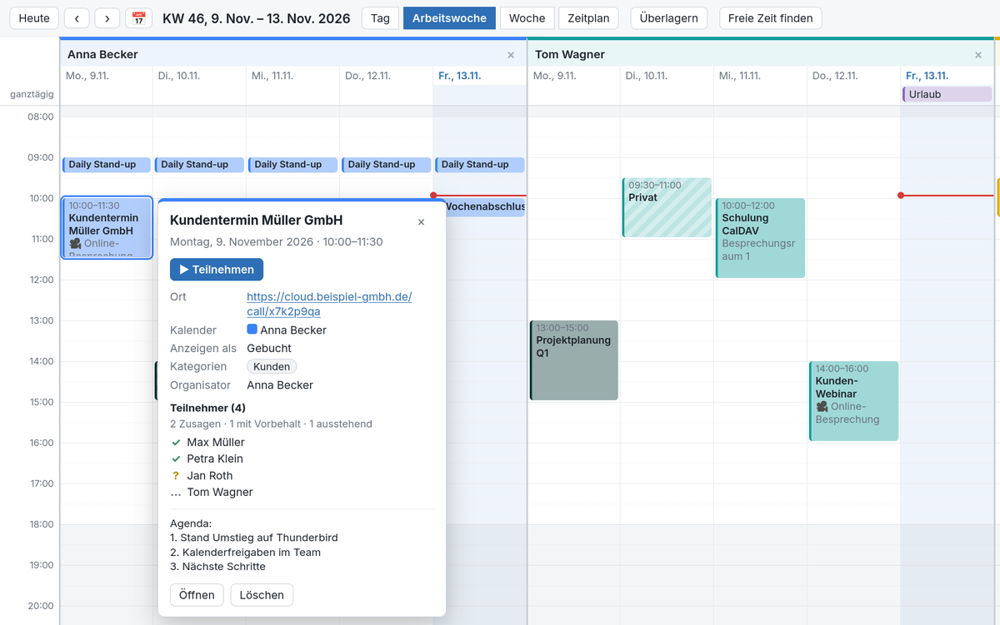
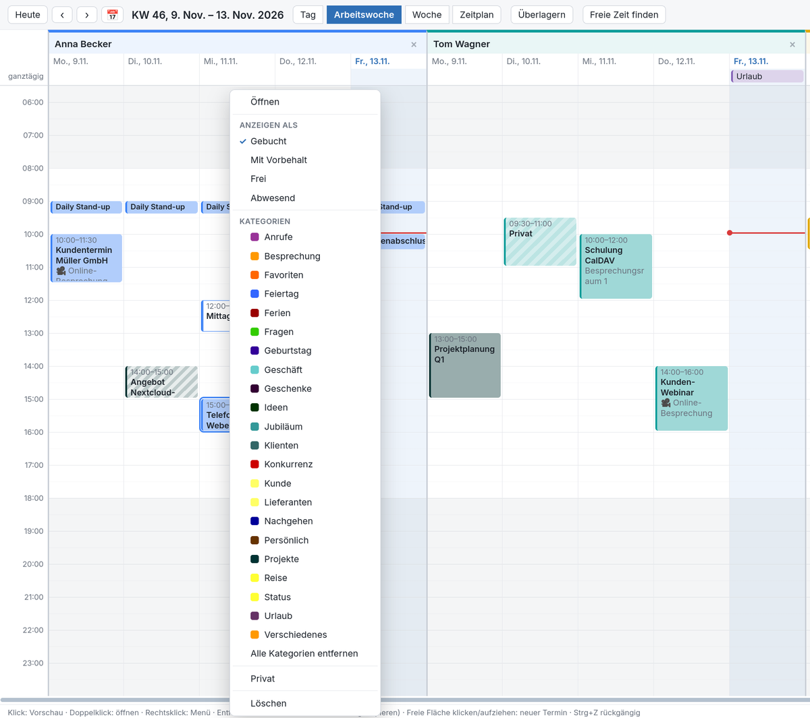
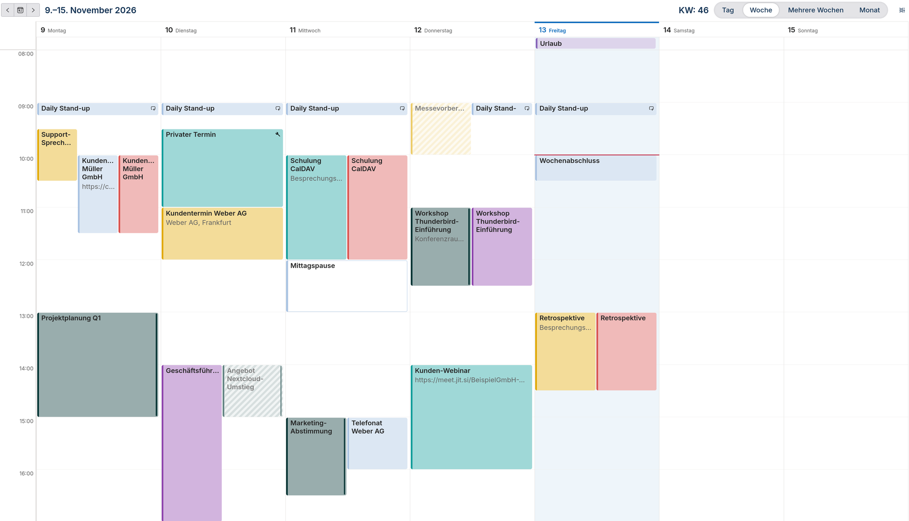

# Team Calendar for Thunderbird (Beta)

**Colleagues’ and room calendars side by side – like in Outlook.**
Team Calendar adds the team features to Thunderbird’s calendar that people
switching from Outlook miss. It works with every calendar set up in Thunderbird,
e.g. CalDAV from **Nextcloud** or **Mailcow/SOGo**.

[Deutsche Version](README.md)

> ⚠️ **Beta.** Please try it with test events first. Report bugs and ideas as an
> [issue](https://github.com/Stefan2706/teamkalender/issues/new/choose).

## Screenshots

**Colleagues’ calendars side by side**

**Schedule view with rooms and “Find free time”**

| Event preview with “Join” | Right-click menu |
|---|---|
|  |  |

**Outlook-style design for Thunderbird’s calendar**

*Screenshots show the German user interface; the add-on is also available in English.*

## Features
- **Side by side, overlay and schedule view** – calendars in their own columns,
  merged into one view, or as rows on a horizontal timeline
- **Day, work week, week** and **individual days via Ctrl + click**, month
  picker with **week numbers**
- **Find free time** across all selected calendars, optionally with a free room
- **Rooms**: book room calendars and include them in the room search
- **Event preview** with attendees (accepted/declined) and a **Join button** for
  Nextcloud Talk, Jitsi, BigBlueButton, Teams, Zoom and more
- **Drag** to move (meetings too – Thunderbird notifies attendees), **Ctrl + drag**
  to copy, **drag a range** to create, **right-click menu**, **Del** to delete,
  **Ctrl + Z** to undo
- **Show as** (busy, tentative, free, out of office) and **colour categories**
- **Outlook-style design for Thunderbird’s calendar** (optional)
- **Colleagues’ private events** shown only as “Private”, working hours highlighted
- Saved calendar groups, printing, keyboard shortcuts (T, ←/→, 1–4)
- German and English, light and dark mode

## Installation
1. Download the latest `teamkalender-x.y.z.xpi` from
   [Releases](https://github.com/Stefan2706/teamkalender/releases).
2. Thunderbird → ☰ → **Add-ons and Themes** → gear icon →
   **Install Add-on From File…**
3. **Team Calendar** appears in the left spaces bar (plus a toolbar button and an
   entry in the **Tools** menu).

Updates are installed automatically afterwards (on the next restart).

**Requirements:** Thunderbird 128 or newer with calendars set up (e.g. CalDAV).
Thunderbird does not support Exchange calendars yet, so they won’t appear either.

## Privacy
Team Calendar **does not send any data**. It only reads the calendars configured
in your Thunderbird and stores its settings locally. The only network request is
the update check on GitHub.

## Technical note
Thunderbird has no official add-on API for calendars yet, so Team Calendar uses
an **Experiment API** with full access to Thunderbird. Major Thunderbird updates
may require an adjustment – businesses should consider Thunderbird **ESR**.

## License
[Mozilla Public License 2.0](LICENSE) · © Stefan Scherer,
[ts-scherer.com](https://ts-scherer.com)

“Outlook” is a trademark of Microsoft Corporation. Team Calendar is not
affiliated with Microsoft or Mozilla.
